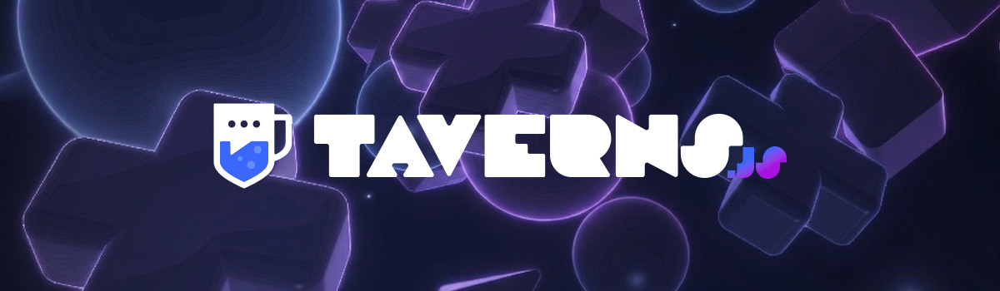

<p align="center">
  
</p>

# taverns.js

SDK for building Tavern bots for the [Taverns](https://tav.gg) platform.

## Installation

```bash
npm install taverns.js
```

## Quick Start

```typescript
import { Client } from 'taverns.js';

const client = new Client({ token: 'tavbot_your_token_here' });

client.on('ready', () => {
  console.log(`Logged in as ${client.user.displayName}`);
  console.log(`Connected to ${client.taverns.size} tavern(s)`);
});

client.on('messageCreate', async (message) => {
  // Ignore messages from bots (including self)
  if (message.sender.id === client.user.id) return;

  if (message.content === '!ping') {
    await message.reply('Pong!');
  }

  if (message.content === '!info') {
    const tavern = client.taverns.get(message.tavernId);
    await message.reply(`This tavern is "${tavern?.name}" with ${tavern?.memberCount} members.`);
  }
});

client.on('memberJoin', (event) => {
  console.log(`${event.displayName} joined tavern ${event.tavernId}`);
});

client.on('error', (error) => {
  console.error('Client error:', error);
});

client.login();
```

## Features

- **Familiar API** - Client, Collection, PermissionsBitField
- **Auto-reconnect** - Exponential backoff with jitter on disconnect
- **Rate limiting** - Automatic handling of API rate limits with retries
- **Type-safe** - Full TypeScript support with type-safe event emitter
- **Caching** - Taverns, channels, and members cached automatically
- **Message helpers** - `message.reply()`, `message.edit()`, `message.delete()`, `message.react()`

## Core Concepts

### Client

The main class. Manages the WebSocket connection, caches, and provides convenience methods.

```typescript
const client = new Client({
  token: 'tavbot_...',        // Required (or pass to login())
  apiUrl: '...',               // Override REST API URL (https:// only)
  wsUrl: '...',                // Override WebSocket URL (wss:// only)
  allowInsecure: false,        // true accepts http:// and ws:// (local development only)
  autoReconnect: true,         // Auto-reconnect on disconnect
  maxReconnectAttempts: 10,    // Give up after N attempts
  heartbeatInterval: 30000,    // Heartbeat interval (ms)
});

await client.login();
```

### Events

```typescript
// Lifecycle
client.on('ready', () => { ... });
client.on('disconnected', (code, reason) => { ... });
client.on('reconnecting', (attempt) => { ... });
client.on('error', (error) => { ... });
client.on('debug', (message) => { ... });

// Messages
client.on('messageCreate', (message) => { ... });
client.on('messageUpdate', (event) => { ... });
client.on('messageDelete', (event) => { ... });
client.on('messageDeleteBulk', (event) => { ... });

// Members
client.on('memberJoin', (event) => { ... });
client.on('memberLeave', (event) => { ... });

// Channels
client.on('channelCreate', (channel) => { ... });
client.on('channelUpdate', (event) => { ... });
client.on('channelDelete', (event) => { ... });

// Roles
client.on('roleUpdate', (role) => { ... });
client.on('roleDelete', (event) => { ... });

// Bot lifecycle
client.on('botInstalled', (event) => { ... });
client.on('botRemoved', (event) => { ... });

// Direct messages (DIRECT_MESSAGES intent)
client.on('dmMessageCreate', (message) => { ... });
client.on('dmMessageUpdate', (message) => { ... });
client.on('dmMessageDelete', (event) => { ... });

// Raw gateway events
client.on('raw', (eventName, data) => { ... });
```

### Permissions

```typescript
import { PermissionsBitField } from 'taverns.js';

const perms = new PermissionsBitField(tavern.grantedPermissions);

if (perms.has('SEND_MESSAGES')) {
  // Bot can send messages
}

if (perms.has('ADMINISTRATOR')) {
  // Bot has full admin access (everything except Listen in voice halls, which is always granted on its own)
}

console.log(perms.toArray());
// ['VIEW_CHANNELS', 'SEND_MESSAGES', 'READ_MESSAGE_HISTORY', ...]
```

### Collections

```typescript
// Taverns collection (extends Map)
const tavern = client.taverns.find(t => t.name === 'My Tavern');
const textChannels = client.channels.filter(c => c.type === 'TEXT');
const firstTavern = client.taverns.first();
const names = client.taverns.map(t => t.name);
```

### REST API

For advanced use, access the REST client directly:

```typescript
// Direct REST calls
const channels = await client.rest.getChannels(tavernId);
const members = await client.rest.getMembers(tavernId);
const message = await client.rest.sendMessage(tavernId, channelId, {
  content: 'Hello!',
});
```

IDs passed to the REST helpers are escaped, so an ID taken from user input (a command option, message
text) cannot point a request at another route. The low-level `client.rest.get/post/patch/put/delete`
methods send the path you give them unchanged.

A request answered with 429 is sent again after the wait the API asks for. After a server error (5xx) or
a dropped connection, only GET and PUT requests are sent again; POST, PATCH and DELETE requests are sent
again only when the connection could not be opened at all, so a message, a kick or a ban is never sent
twice. A request that still fails rejects with `TavernAPIError` (or the network error).

## Webhook Verification

If your bot receives events by webhook, verify every request before you trust it:

```typescript
import express from 'express';
import { verifyWebhookSignature } from 'taverns.js';

const secret = process.env.WEBHOOK_SECRET;
if (!secret) throw new Error('Set WEBHOOK_SECRET'); // an empty secret makes the check throw

app.post('/webhook', express.raw({ type: 'application/json' }), (req, res) => {
  const valid = verifyWebhookSignature(
    req.body,                      // the raw body (Buffer), not parsed JSON
    req.get('x-tavern-signature'),
    secret,
    req.get('x-tavern-timestamp'),
  );
  if (!valid) return res.status(401).send('Invalid signature');

  const { event, data } = JSON.parse(req.body.toString('utf8'));
  res.status(200).send('OK');
});
```

The signature covers the raw request body. Requests older than 5 minutes, judged by the `timestamp`
inside the signed body, are refused; pass a different `maxAge` (seconds) as the fifth argument to change
that.

## Direct Messages

A bot can message a person who is in a tavern where the bot is installed, as long as the person allows DMs from
bots (the default) or wrote to the bot, or used one of its commands, in the last 24 hours. People can block and
report bots, and the apps mark the DM as an app, not a person. Message people because they asked for it (a
command, a reminder they set), not to advertise.

The `DIRECT_MESSAGES` intent (`1n << 16n`, in `DEFAULT`, not privileged) delivers what people send the bot. The
content is always included.

```typescript
import { RateLimitError, TavernAPIError } from 'taverns.js';

client.on('dmMessageCreate', async (message) => {
  if (message.content === 'help') await message.reply('Try /play or /queue in a tavern.');
});

try {
  await client.sendDM(userId, { content: 'Your reminder:', embeds: [embed] }); // opens the DM once, then reuses it
} catch (err) {
  if (err instanceof TavernAPIError && err.code === 'CANNOT_DM_USER') { /* they can't be messaged */ }
  if (err instanceof RateLimitError) console.log(err.scope, err.retryAfter); // a DM limit: not resent for you
}
```

Also: `client.createDM(userId)`, `client.sendDMMessage(channelId, content)`, `client.getDMChannel(channelId)`,
`client.getDMMessages(channelId, { before, limit })`, `client.editDMMessage(channelId, messageId, content)`,
`client.deleteDMMessage(channelId, messageId)` (the same on `client.rest`). DMs have their own limits per person and
per bot; see [Direct Messages](https://tav.gg/developers/docs/dms) and
[Rate Limits](https://tav.gg/developers/docs/rate-limits).

## Voice Halls

Bots can play audio in a tavern's voice halls, and hear them when the tavern allows it.

```bash
npm install @livekit/rtc-node     # required for voice
npm install ffmpeg-static         # optional: or install ffmpeg yourself
```

```typescript
const connection = await client.voice.join(voiceHallId); // pass { tavernId } if the hall is not cached

await connection.play('./music/intro.mp3');            // a file, an http(s) URL, or a readable stream
await connection.play('https://example.com/radio.ogg', { volume: 0.5 });
await connection.playPCM(pcmStream);                   // raw 48 kHz signed 16-bit LE, stereo (or { channels: 1 })

connection.pause();
connection.resume();
connection.stop();
await connection.leave();

connection.on('disconnected', (reason) => console.log('left voice:', reason));
```

**Rules**

- What the bot needs in that hall: **Connect** plus **Speak** to play, **Connect** plus **Listen in voice halls** to
  hear (see below). One of Speak or Listen is enough to join: a bot with Connect and Listen but no Speak joins
  **listen-only**. It cannot join 18+ halls.
- `connection.canSpeak` says whether the bot may play. On a listen-only connection, `play()` and `playPCM()` throw
  an error (`code: 'VOICE_CANNOT_SPEAK'`) and nothing is published. The audio track is published on the first
  play.
- Speak and Listen follow the tavern live. Losing Speak stops what is playing and the bot stays to listen (if it
  may); getting Speak back lets the next play work again. Watch `connection.on('canSpeak', (on) => ...)` and
  `connection.on('listening', (on) => ...)`.
- One voice connection per tavern: joining another hall of the same tavern moves the bot there.
- The connection renews itself before its token expires (about every 8 minutes). If it cannot, it ends with
  `'expired'` or `'renewal_refused'`.
- Members see the bot in the hall with a bot badge. Moderators who can disconnect members can disconnect the bot
  (`'moderator'`). Removing, turning off or banning the bot in the tavern, or taking away both Speak and Listen,
  also takes it out (`'access_removed'`).
- The bot's audio is not end-to-end encrypted. While a bot is in a hall, the hall is not end-to-end encrypted for
  anyone, and the apps say so.
- Joins are rate limited (6 a minute per tavern, 60 a minute per bot).

**Disconnect reasons:** `left`, `moved`, `moderator`, `access_removed`, `bot_disabled`, `expired`, `left_room`,
`renewal_refused`, `connection_lost`.

### Hearing a hall (Listen in voice halls)

A bot hears a voice hall only when **it requests** the `LISTEN_VOICE` permission ("Listen in voice halls") **and the
tavern grants it** when installing the bot. It is never granted by default, **Administrator does not include it**, and
a hall can turn it off for the bot. While a listening bot is in a hall, every member sees a "listening" marker on it.
A bot that only needs to hear (a recorder, a transcriber) does not need Speak.

```typescript
if (connection.listening) {
  connection.on('audio', (frame) => {
    // frame.userId, frame.isBot, frame.source ('microphone' | 'screen_share_audio')
    // frame.pcm: Int16Array, 48 kHz mono, 20 ms per frame
  });
  connection.on('speaking', ({ userId, speaking }) => console.log(userId, speaking ? 'started' : 'stopped'));
}
connection.on('listening', (on) => console.log('the tavern', on ? 'granted' : 'took away', 'listening'));
```

The SDK subscribes to microphones and screen-share sound only, never cameras or screens. **If your bot records,
transcribes or otherwise processes what people say, say so in your bot's description and privacy policy**, and make
sure the people in the hall know. Many communities expect consent before anyone is recorded.

**REST endpoints** (if you are not using the SDK):

| Method | Path | Body | Answer |
|---|---|---|---|
| `POST` | `/bots/@me/taverns/:tavernId/voice/:channelId/join` | none | `{ url, token, identity, room, expiresAt, listening, canSpeak }` |
| `POST` | `/bots/@me/taverns/:tavernId/voice/leave` | none | `{ success, left }` |

Call join again before `expiresAt` to stay in the hall. With `canSpeak: false` the media token cannot publish. The
gateway sends the bot `bot_voice_disconnected` (`{ tavernId, channelId, reason }`) and `bot_voice_updated`
(`{ tavernId, channelId, listening, canSpeak }`).

## Bot Token

Bot tokens start with `tavbot_` and are generated in the Taverns developer portal. Never commit your token to source control.

```typescript
// Use environment variables
const client = new Client({ token: process.env.TAVERN_BOT_TOKEN });
```

The token is sent only over `https://` and `wss://`, and the SDK never writes it to `debug` output. If the
gateway refuses the token (revoked, regenerated, or the bot was disabled), the client stops reconnecting
and emits an `error` event that starts with "Authentication failed".

## API Reference

### Client Methods

| Method | Description |
|---|---|
| `login(token?)` | Connect and authenticate |
| `destroy()` | Disconnect and clean up |
| `sendMessage(tavernId, channelId, options)` | Send a message |
| `editMessage(tavernId, messageId, options)` | Edit a message |
| `deleteMessage(tavernId, messageId)` | Delete a message |
| `getMessages(tavernId, channelId, options?)` | Fetch messages |
| `createChannel(tavernId, options)` | Create a channel |
| `updateChannel(tavernId, channelId, options)` | Update a channel |
| `deleteChannel(tavernId, channelId)` | Delete a channel |
| `getMembers(tavernId, options?)` | List tavern members |
| `getMember(tavernId, userId)` | Get a specific member |
| `kickMember(tavernId, userId, reason?)` | Kick a member (requires `KICK_MEMBERS`) |
| `banMember(tavernId, userId, options?)` | Ban a member (requires `BAN_MEMBERS`) |
| `unbanMember(tavernId, userId)` | Lift a ban (requires `BAN_MEMBERS`) |
| `muteMember(tavernId, userId, options?)` | Mute/timeout a member (requires `MUTE_MEMBERS`) |
| `unmuteMember(tavernId, userId)` | Remove a mute (requires `MUTE_MEMBERS`) |
| `sendDM(userId, content)` | Send a direct message (opens the DM the first time) |
| `createDM(userId)` | Open a direct message, or get the existing one |
| `sendDMMessage(channelId, content)` | Send in a direct message that is already open |
| `getDMChannel(channelId)` | Get a direct message |
| `getDMMessages(channelId, options?)` | Fetch messages from a direct message (`before`, `limit`) |
| `editDMMessage(channelId, messageId, content)` | Edit the bot's own direct message |
| `deleteDMMessage(channelId, messageId)` | Delete the bot's own direct message |

> **Owner immunity:** the tavern owner can never be kicked, banned, or muted — by anyone, including bots with `ADMINISTRATOR`. The API rejects any such attempt.

### ActionableMessage Methods

Messages received via `messageCreate` have these helper methods:

| Method | Description |
|---|---|
| `message.reply(content)` | Reply to the message |
| `message.edit(content)` | Edit the message |
| `message.delete()` | Delete the message |
| `message.pin()` | Pin the message |
| `message.unpin()` | Unpin the message |
| `message.react(emoji)` | Add a reaction |

Messages received via `dmMessageCreate` have `message.reply(content)`, which answers in the same direct message.

## Links

- [npm package](https://www.npmjs.com/package/taverns.js)
- [API Documentation](https://tav.gg/developers/docs)
- [Developer Portal](https://tav.gg/developers/home)
- [taverns.py](https://github.com/Tav-gg/taverns.py) (Python SDK)

## License

Apache-2.0 - see [LICENSE](LICENSE) for details.
